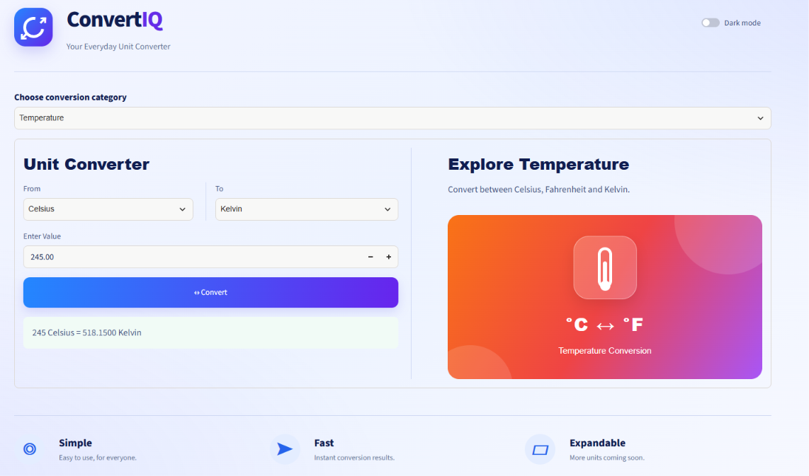
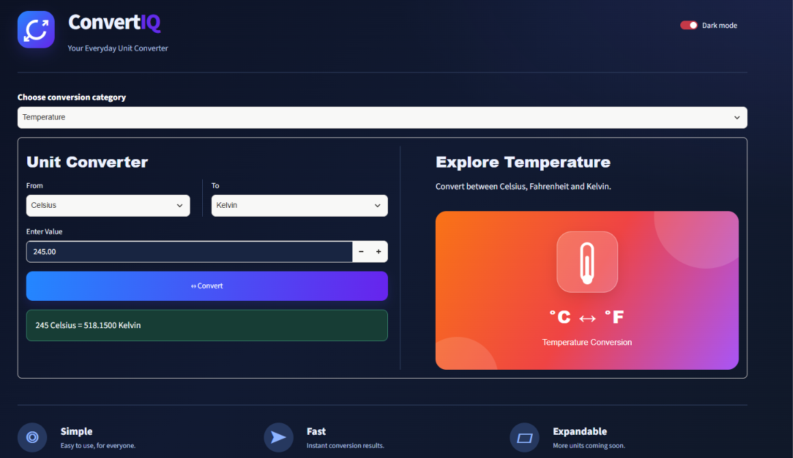

<div align="center">

# ConvertIQ

### Your everyday unit converter.

A clean, responsive unit-conversion app built with Python and Streamlit, featuring four conversion categories and Light/Dark themes.

[](https://convertiq-devaamirreza.streamlit.app/)
[](https://www.python.org/)
[](https://streamlit.io/)
[](LICENSE)

</div>

---

## 🌓 ConvertIQ in Light & Dark Mode

<div align="center">
  
  
</div>

<div align="center">
  <sub>One simple workspace. Two comfortable themes.</sub>
</div>

## ✨ Overview

ConvertIQ makes everyday unit conversions simple. Choose a category, select the source and target units, enter a value, and get the converted result.

The interface brings the converter and category-specific visual panel together in one workspace, with a theme toggle for comfortable use in both light and dark environments.

## 🚀 Live Demo

**[Launch ConvertIQ](https://convertiq-devaamirreza.streamlit.app/)**

## 🧰 Features

- **Length:** Kilometres ↔ Metres
- **Weight:** Kilograms ↔ Grams
- **Temperature:** Celsius ↔ Fahrenheit ↔ Kelvin
- **Volume:** Litres ↔ Millilitres
- Light and Dark themes
- Conversion results persist when switching themes
- Category-specific visual panel
- Reusable conversion functions in a separate Python module

## 🛠️ Built With

- [Python](https://www.python.org/)
- [Streamlit](https://streamlit.io/)
- Custom CSS
- Git and GitHub

## 📁 Project Structure

```text
ConvertIQ/
├── assets/
│   ├── convertiq-light.png
│   └── convertiq-dark.png
├── app.py
├── conversions.py
├── requirements.txt
├── README.md
├── LICENSE
└── .gitignore
```

## ⚙️ Run Locally

### 1. Clone the repository

```bash
git clone https://github.com/devaamirreza/ConvertIQ.git
cd ConvertIQ
```

### 2. Create and activate a virtual environment

**Windows**

```bash
python -m venv .venv
.venv\Scripts\activate
```

**macOS / Linux**

```bash
python -m venv .venv
source .venv/bin/activate
```

### 3. Install dependencies

```bash
pip install -r requirements.txt
```

### 4. Run ConvertIQ

```bash
streamlit run app.py
```

The app will usually open at `http://localhost:8501`.

## 🧠 Code Structure

The project separates the user interface from the conversion logic:

- `app.py` manages the Streamlit interface, category selection, theme state and result display.
- `conversions.py` contains reusable conversion functions and the `convert_units()` router.

This separation makes the project easier to understand, test and extend.

## 🗺️ Roadmap

- [ ] Add more length, weight and volume units
- [ ] Add area and speed conversions
- [ ] Add conversion history
- [ ] Add automated tests
- [ ] Further improve mobile layout and accessibility

## 🤝 Contributions

Suggestions and improvements are welcome. Feel free to open an issue or submit a pull request.

## 📄 License

Distributed under the MIT License. See [`LICENSE`](LICENSE) for details.

---

<div align="center">

**Built with Python, Streamlit and curiosity.**

</div>
